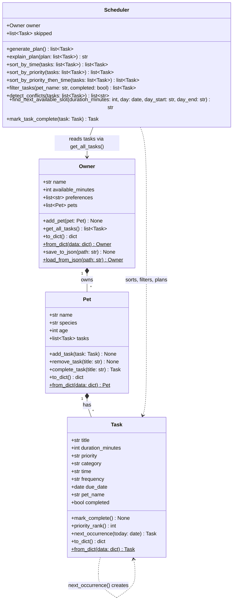

# 🐾 PawPal+

PawPal+ is a Streamlit app that helps a busy pet owner plan the day's pet care. You add your pets and their tasks (walks, feeding, meds, grooming, play), tell it how much time you have, and it builds a daily plan. It puts the most important tasks first, warns you when two tasks clash, and explains why it picked what it did.

## ✨ Features

- **Multiple pets:** one owner can have several pets, and every feature works across all of them.
- **Daily plan within your free time:** the most important tasks get picked first, and anything that doesn't fit in your available minutes is skipped (with a reason).
- **Sorting by time:** tasks are listed by date and then by time of day. Tasks with no set time go at the end.
- **Sorting by priority:** high priority comes first, and the shorter task wins a tie, so more tasks fit in the day.
- **Filtering:** see tasks for one pet, only the ones that still need doing, only finished ones, or a mix.
- **Conflict warnings:** if two tasks overlap in time (same pet or different pets), the app shows a warning instead of crashing.
- **Daily and weekly recurrence:** when you finish a repeating task, the next one is added automatically. Daily tasks come back tomorrow. Weekly tasks stay on the same weekday, even if you finish them late.
- **Priority, then time view:** see all high-priority tasks in time order, then medium, then low.
- **Next available slot:** finds the earliest free time today where a new task fits without clashing with anything.
- **Saves your data:** pets and tasks are saved to `data.json`, so they're still there the next time you open the app.
- **Clean, readable output:** emojis for task types and priority, colored status in the terminal, and neat tables using `tabulate`.
- **Plan explanation:** a plain-English summary of why each task was chosen or skipped.
- **Input check:** priority must be low, medium, or high, so a typo can't break the sorting.

## 🚀 Getting started

### Setup

```bash
python -m venv .venv
source .venv/bin/activate  # Windows: .venv\Scripts\activate
pip install -r requirements.txt
```

### Run it

```bash
streamlit run app.py   # the web app
python main.py         # terminal demo
python -m pytest       # tests
```

## 🏗️ Architecture

The code is split into a logic layer (`pawpal_system.py`) and a UI (`app.py`). `Owner`, `Pet`, and `Task` hold the data, and `Scheduler` does all of the planning. The source for this diagram is in [`diagrams/uml_final.mmd`](diagrams/uml_final.mmd).



## 🖥️ Sample Output

Output from running `python main.py` (one owner, two pets, seven tasks added out of order, 90-minute daily budget). It shows sorting, priority sorting, filtering, conflict warnings, free slots, the plan, a recurring task, and saving/loading. In a real terminal the status column and warnings are colored. The colors are turned off when the output is copied or piped, so this block is plain text.

```
1. Sorted by time
╭─────────┬───────────────────────┬─────────┬───────┬────────────┬────────────┬──────────╮
│ Time    │ Task                  │ Pet     │   Min │ Priority   │ Due        │ Status   │
├─────────┼───────────────────────┼─────────┼───────┼────────────┼────────────┼──────────┤
│ 07:30   │ 🦮 Morning walk       │ Mochi   │    30 │ 🔴 high    │ Sat Oct 17 │ ○ open   │
│ 07:30   │ 🍖 Breakfast          │ Biscuit │    10 │ 🔴 high    │ Sat Oct 17 │ ○ open   │
│ 18:00   │ 🦮 Evening walk       │ Mochi   │    25 │ 🟡 medium  │ Sat Oct 17 │ ○ open   │
│ 18:00   │ 💊 Flea treatment     │ Mochi   │     5 │ 🟡 medium  │ Sat Oct 17 │ ○ open   │
│ 19:30   │ 🎾 Laser pointer play │ Biscuit │    15 │ 🟡 medium  │ Sat Oct 17 │ ○ open   │
│ 20:00   │ 💊 Thyroid meds       │ Biscuit │     5 │ 🔴 high    │ Sat Oct 17 │ ○ open   │
│ anytime │ 🛁 Bath and brush     │ Mochi   │    40 │ 🟢 low     │ Sat Oct 17 │ ○ open   │
╰─────────┴───────────────────────┴─────────┴───────┴────────────┴────────────┴──────────╯

2. Sorted by priority, then time
╭─────────┬───────────────────────┬─────────┬───────┬────────────┬────────────┬──────────╮
│ Time    │ Task                  │ Pet     │   Min │ Priority   │ Due        │ Status   │
├─────────┼───────────────────────┼─────────┼───────┼────────────┼────────────┼──────────┤
│ 07:30   │ 🦮 Morning walk       │ Mochi   │    30 │ 🔴 high    │ Sat Oct 17 │ ○ open   │
│ 07:30   │ 🍖 Breakfast          │ Biscuit │    10 │ 🔴 high    │ Sat Oct 17 │ ○ open   │
│ 20:00   │ 💊 Thyroid meds       │ Biscuit │     5 │ 🔴 high    │ Sat Oct 17 │ ○ open   │
│ 18:00   │ 🦮 Evening walk       │ Mochi   │    25 │ 🟡 medium  │ Sat Oct 17 │ ○ open   │
│ 18:00   │ 💊 Flea treatment     │ Mochi   │     5 │ 🟡 medium  │ Sat Oct 17 │ ○ open   │
│ 19:30   │ 🎾 Laser pointer play │ Biscuit │    15 │ 🟡 medium  │ Sat Oct 17 │ ○ open   │
│ anytime │ 🛁 Bath and brush     │ Mochi   │    40 │ 🟢 low     │ Sat Oct 17 │ ○ open   │
╰─────────┴───────────────────────┴─────────┴───────┴────────────┴────────────┴──────────╯

3. Filtered: Biscuit only
╭────────┬───────────────────────┬─────────┬───────┬────────────┬────────────┬──────────╮
│ Time   │ Task                  │ Pet     │   Min │ Priority   │ Due        │ Status   │
├────────┼───────────────────────┼─────────┼───────┼────────────┼────────────┼──────────┤
│ 07:30  │ 🍖 Breakfast          │ Biscuit │    10 │ 🔴 high    │ Sat Oct 17 │ ○ open   │
│ 19:30  │ 🎾 Laser pointer play │ Biscuit │    15 │ 🟡 medium  │ Sat Oct 17 │ ○ open   │
│ 20:00  │ 💊 Thyroid meds       │ Biscuit │     5 │ 🔴 high    │ Sat Oct 17 │ ○ open   │
╰────────┴───────────────────────┴─────────┴───────┴────────────┴────────────┴──────────╯

4. Conflict check
  ⚠️  'Morning walk' (Mochi, 07:30-08:00) overlaps 'Breakfast' (Biscuit, 07:30-07:40)
  ⚠️  'Evening walk' (Mochi, 18:00-18:25) overlaps 'Flea treatment' (Mochi, 18:00-18:05)

5. Next available slot
  A 10-minute task fits at: 07:00
  A 40-minute task fits at: 08:00

6. Today's schedule
╭────────┬───────────────────────┬─────────┬───────┬────────────┬────────────┬──────────╮
│ Time   │ Task                  │ Pet     │   Min │ Priority   │ Due        │ Status   │
├────────┼───────────────────────┼─────────┼───────┼────────────┼────────────┼──────────┤
│ 07:30  │ 🍖 Breakfast          │ Biscuit │    10 │ 🔴 high    │ Sat Oct 17 │ ○ open   │
│ 07:30  │ 🦮 Morning walk       │ Mochi   │    30 │ 🔴 high    │ Sat Oct 17 │ ○ open   │
│ 18:00  │ 💊 Flea treatment     │ Mochi   │     5 │ 🟡 medium  │ Sat Oct 17 │ ○ open   │
│ 18:00  │ 🦮 Evening walk       │ Mochi   │    25 │ 🟡 medium  │ Sat Oct 17 │ ○ open   │
│ 19:30  │ 🎾 Laser pointer play │ Biscuit │    15 │ 🟡 medium  │ Sat Oct 17 │ ○ open   │
│ 20:00  │ 💊 Thyroid meds       │ Biscuit │     5 │ 🔴 high    │ Sat Oct 17 │ ○ open   │
╰────────┴───────────────────────┴─────────┴───────┴────────────┴────────────┴──────────╯
Plan for Jordan: 90 of 90 minutes used.
    07:30  Breakfast (Biscuit), 10 min, chosen because it is high priority and fits the time budget
    07:30  Morning walk (Mochi), 30 min, chosen because it is high priority and fits the time budget
    18:00  Flea treatment (Mochi), 5 min, chosen because it is medium priority and fits the time budget
    18:00  Evening walk (Mochi), 25 min, chosen because it is medium priority and fits the time budget
    19:30  Laser pointer play (Biscuit), 15 min, chosen because it is medium priority and fits the time budget
    20:00  Thyroid meds (Biscuit), 5 min, chosen because it is high priority and fits the time budget
  Skipped  Bath and brush (Mochi): needs 40 min, only 0 min left after higher-priority tasks
  Warning: 'Breakfast' (Biscuit, 07:30-07:40) overlaps 'Morning walk' (Mochi, 07:30-08:00)
  Warning: 'Flea treatment' (Mochi, 18:00-18:05) overlaps 'Evening walk' (Mochi, 18:00-18:25)

7. Recurring task
  Completed 'Morning walk' -> next one created for Sun Oct 18
╭─────────┬───────────────────┬───────┬───────┬────────────┬────────────┬──────────╮
│ Time    │ Task              │ Pet   │   Min │ Priority   │ Due        │ Status   │
├─────────┼───────────────────┼───────┼───────┼────────────┼────────────┼──────────┤
│ 07:30   │ 🦮 Morning walk   │ Mochi │    30 │ 🔴 high    │ Sat Oct 17 │ ✔ done   │
│ 18:00   │ 🦮 Evening walk   │ Mochi │    25 │ 🟡 medium  │ Sat Oct 17 │ ○ open   │
│ 18:00   │ 💊 Flea treatment │ Mochi │     5 │ 🟡 medium  │ Sat Oct 17 │ ○ open   │
│ anytime │ 🛁 Bath and brush │ Mochi │    40 │ 🟢 low     │ Sat Oct 17 │ ○ open   │
│ 07:30   │ 🦮 Morning walk   │ Mochi │    30 │ 🔴 high    │ Sun Oct 18 │ ○ open   │
╰─────────┴───────────────────┴───────┴───────┴────────────┴────────────┴──────────╯

8. Save and load
  Saved and reloaded 2 pets and 8 tasks.
  Reloaded data matches the original: True
```

## 🧪 Testing PawPal+

Run the tests from the project folder (with the virtual environment turned on):

```bash
python -m pytest
```

### What the tests cover

All tests are in `tests/test_pawpal.py` (36 tests):

- **Basics:** marking a task done, adding tasks to a pet, getting every pet's tasks from the owner, and making sure priority only accepts low, medium, or high.
- **Sorting:** tasks come back in time order, tasks with no time go last, "9:00" sorts before "10:00", earlier dates come first, and high priority comes before low.
- **Filtering:** by pet, by done or not done, both together, and a pet with no tasks.
- **Recurring tasks:** finishing a daily task adds one for tomorrow, a weekly task comes back in 7 days, one-time tasks don't repeat, and an overdue daily task comes back tomorrow instead of on a day that's already passed.
- **Conflicts:** two tasks at the exact same time (same pet or different pets) get flagged, and so do tasks that only partly overlap. Back-to-back tasks, tasks on different days, and tasks with no time are not flagged.
- **Daily plan:** the plan stays within the owner's free time, skips what doesn't fit, leaves out finished and future tasks, and works with no tasks or zero free minutes.
- **Weekly tasks keep their weekday:** a Saturday task finished late (even a month late) or early still comes back on a Saturday, and never in the past.
- **Priority, then time:** high-priority tasks come first, and each priority group is in time order.
- **Next available slot:** finds the first gap that's big enough, starts at 07:00 on an empty day, ignores finished tasks and other days, and returns nothing when the day is full.
- **Saving and loading:** saving to JSON and loading it back gives the exact same pets and tasks (dates included), and loading a missing file raises an error.

### Test results

```
============================= test session starts ==============================
platform darwin -- Python 3.13.15, pytest-9.1.1, pluggy-1.7.0
rootdir: /Users/jafarsharif.shaik/ai110-module2show-pawpal-starter
configfile: pytest.ini
testpaths: tests
plugins: anyio-4.15.1
collected 36 items

tests/test_pawpal.py ....................................                [100%]

============================== 36 passed in 0.03s ==============================
```

### Confidence level: ⭐⭐⭐⭐ (4/5)

All 36 tests pass, and they cover the main features plus the tricky cases I could think of. I'm not giving it 5 stars because the tests only check the logic in `pawpal_system.py`, not the Streamlit app. Also, the scheduler doesn't check for bad input like a time typed as "25:99" or a negative duration.

## 📐 Smarter Scheduling

All the scheduling code is in the `Scheduler` class in `pawpal_system.py`. It gets tasks from `Owner.get_all_tasks()`, so everything works across all of the owner's pets, not just one.

| Feature | Method(s) | Notes |
|---------|-----------|-------|
| Task sorting | `Scheduler.sort_by_time()`, `Scheduler.sort_by_priority()` | Sorts tasks by date and then by time. Tasks with no set time go at the end of the day. Priority sorting puts high first, and if two tasks tie, the shorter one goes first. |
| Filtering | `Scheduler.filter_tasks(pet_name=None, completed=None)` | Shows tasks for one pet, only done or not-done tasks, or both. |
| Daily plan | `Scheduler.generate_plan()`, `Scheduler.explain_plan()` | Starts with the most important tasks and adds each one if there's still time left in the day. Anything that doesn't fit gets skipped, and the explanation says why. |
| Conflict handling | `Scheduler.detect_conflicts()` | Warns when two tasks overlap in time, whether they're for the same pet or different pets. It just prints a warning and doesn't crash. |
| Recurring tasks | `Scheduler.mark_task_complete()`, `Pet.complete_task()`, `Task.next_occurrence()` | When you finish a daily task, a new one is added for tomorrow. A weekly task comes back on the same weekday the next week (a Saturday task stays on Saturdays, even if you finish it on Monday). One-time tasks just stay done. |
| Priority, then time | `Scheduler.sort_by_priority_then_time()` | Groups tasks by priority (high first) and puts each group in time order. |
| Next available slot | `Scheduler.find_next_available_slot()` | Looks at today's busy times, walks through the gaps from 07:00 to 21:00, and returns the first gap that's long enough. |
| Saving and loading | `Owner.save_to_json()`, `Owner.load_from_json()` | Saves everything to `data.json` and loads it back. |
| Input check | `Task.__post_init__()` | Priority has to be low, medium, or high. Capital letters like "High" are fine. |

## ⭐ Priority-Based Scheduling

Tasks have a priority of low, medium, or high (`Task.priority`). The scheduler uses it in two ways:

1. **Picking tasks for the plan.** `generate_plan()` goes through tasks from high to low priority and keeps each one that still fits in your free time. That's why the low-priority bath gets skipped in the example below.
2. **Showing what matters most.** `sort_by_priority_then_time()` lists all high-priority tasks first, in time order, then medium, then low. In the app, pick **Sort by: Priority, then time** above the task table.

Here's the same set of tasks sorted both ways, from `python main.py`. In the time view the 20:00 thyroid meds are near the bottom. In the priority view they move up with the other high-priority tasks:

```
1. Sorted by time
╭─────────┬───────────────────────┬─────────┬───────┬────────────┬────────────┬──────────╮
│ Time    │ Task                  │ Pet     │   Min │ Priority   │ Due        │ Status   │
├─────────┼───────────────────────┼─────────┼───────┼────────────┼────────────┼──────────┤
│ 07:30   │ 🦮 Morning walk       │ Mochi   │    30 │ 🔴 high    │ Sat Oct 17 │ ○ open   │
│ 07:30   │ 🍖 Breakfast          │ Biscuit │    10 │ 🔴 high    │ Sat Oct 17 │ ○ open   │
│ 18:00   │ 🦮 Evening walk       │ Mochi   │    25 │ 🟡 medium  │ Sat Oct 17 │ ○ open   │
│ 18:00   │ 💊 Flea treatment     │ Mochi   │     5 │ 🟡 medium  │ Sat Oct 17 │ ○ open   │
│ 19:30   │ 🎾 Laser pointer play │ Biscuit │    15 │ 🟡 medium  │ Sat Oct 17 │ ○ open   │
│ 20:00   │ 💊 Thyroid meds       │ Biscuit │     5 │ 🔴 high    │ Sat Oct 17 │ ○ open   │
│ anytime │ 🛁 Bath and brush     │ Mochi   │    40 │ 🟢 low     │ Sat Oct 17 │ ○ open   │
╰─────────┴───────────────────────┴─────────┴───────┴────────────┴────────────┴──────────╯

2. Sorted by priority, then time
╭─────────┬───────────────────────┬─────────┬───────┬────────────┬────────────┬──────────╮
│ Time    │ Task                  │ Pet     │   Min │ Priority   │ Due        │ Status   │
├─────────┼───────────────────────┼─────────┼───────┼────────────┼────────────┼──────────┤
│ 07:30   │ 🦮 Morning walk       │ Mochi   │    30 │ 🔴 high    │ Sat Oct 17 │ ○ open   │
│ 07:30   │ 🍖 Breakfast          │ Biscuit │    10 │ 🔴 high    │ Sat Oct 17 │ ○ open   │
│ 20:00   │ 💊 Thyroid meds       │ Biscuit │     5 │ 🔴 high    │ Sat Oct 17 │ ○ open   │
│ 18:00   │ 🦮 Evening walk       │ Mochi   │    25 │ 🟡 medium  │ Sat Oct 17 │ ○ open   │
│ 18:00   │ 💊 Flea treatment     │ Mochi   │     5 │ 🟡 medium  │ Sat Oct 17 │ ○ open   │
│ 19:30   │ 🎾 Laser pointer play │ Biscuit │    15 │ 🟡 medium  │ Sat Oct 17 │ ○ open   │
│ anytime │ 🛁 Bath and brush     │ Mochi   │    40 │ 🟢 low     │ Sat Oct 17 │ ○ open   │
╰─────────┴───────────────────────┴─────────┴───────┴────────────┴────────────┴──────────╯
```

The free-slot finder (`find_next_available_slot()`) works with this too. After the clash check, it shows the earliest time today where a new task would fit:

```
4. Conflict check
  ⚠️  'Morning walk' (Mochi, 07:30-08:00) overlaps 'Breakfast' (Biscuit, 07:30-07:40)
  ⚠️  'Evening walk' (Mochi, 18:00-18:25) overlaps 'Flea treatment' (Mochi, 18:00-18:05)

5. Next available slot
  A 10-minute task fits at: 07:00
  A 40-minute task fits at: 08:00
```

## 💾 Data Persistence

PawPal+ remembers your pets and tasks between runs by saving them to a `data.json` file.

**How it works:**

1. When the app starts, it checks for `data.json`. If the file is there, it loads your owner info, pets, and tasks with `Owner.load_from_json()`. If not (or if the file is broken), it starts fresh.
2. After every change (adding a pet, adding a task, marking a task done, changing your free minutes), the app saves everything with `Owner.save_to_json()`.
3. The **🗑️ Start over** button in the sidebar deletes the saved data and starts over.

**How the saving works:** JSON can't store Python objects or dates directly, so each class can turn itself into a plain dictionary and back. `Task.to_dict()` uses `dataclasses.asdict()` and turns the due date into text like `"2026-10-17"`. `Task.from_dict()` turns it back into a date. `Pet` and `Owner` do the same for their lists of tasks and pets. I chose this over a library like marshmallow because the data is small and simple, and it keeps the project free of extra dependencies.

`data.json` is in `.gitignore`, because it's personal data and shouldn't be committed.

**Files changed:**

- `pawpal_system.py`: added `to_dict()` and `from_dict()` to `Task`, `Pet`, and `Owner`, plus `Owner.save_to_json()` and `Owner.load_from_json()`.
- `app.py`: loads `data.json` at startup, saves after every change, and has the **Start over** button.
- `main.py`: saves to a temporary file, loads it back, and checks that nothing changed.
- `tests/test_pawpal.py`: tests for a save/load round trip and a missing file.
- `.gitignore`: ignores `data.json`.

## 🎨 Output Formatting

| Feature | Where | How |
|---|---|---|
| Emojis for task types | CLI and app | `CATEGORY_EMOJI` in `pawpal_system.py`: 🦮 walk, 🍖 feeding, 💊 meds, 🛁 grooming, 🎾 enrichment, 📝 general |
| Color-coded priority | CLI and app | `PRIORITY_EMOJI` in `pawpal_system.py`: 🔴 high, 🟡 medium, 🟢 low |
| Neat CLI tables | `main.py` → `show()` | The [`tabulate`](https://pypi.org/project/tabulate/) library with the `rounded_outline` style. It's installed as `tabulate[widechars]`, so emojis don't throw off the column widths. |
| Colored status in the terminal | `main.py` → `color()` | ANSI color codes: green for **✔ done**, yellow for **○ open**, red for conflict warnings. They're only used when printing to a real terminal (`sys.stdout.isatty()`), so copied output stays clean. |
| Status in the app | `app.py` → `task_rows()` | ✅ done / ⏳ to do |
| Summary numbers | `app.py` | `st.metric` for tasks planned, minutes used, and tasks skipped |
| Clear warnings | `app.py` → `show_conflicts()` | One `st.warning` box that lists every clash, with a tip on what to do |

## 📸 Demo Walkthrough

### What you can do in the app

The app is one page with four sections, from top to bottom:

- **Owner:** set your name and how many minutes you have for pet care today.
- **Pets:** add a pet with a name, species, and age. The app won't let you add two pets with the same name.
- **Tasks:** add a task for a pet with a title, how long it takes, priority, category, an optional start time, and whether it repeats (once, daily, or weekly). You can also check **Pick the next free time for me** to have the app choose the earliest open time. Below the form is a table of tasks that you can filter by pet and by status (all, not done, done), and sort by time or by priority then time. You can also pick any open task and mark it done.
- **Today's Schedule:** press **Generate schedule** to get today's plan.
- **Sidebar:** your data saves automatically. **🗑️ Start over** clears it.

### Example workflow

1. Run `streamlit run app.py`. Set the owner name to **Jordan** and minutes available to **60**.
2. Add two pets: **Mochi** (dog) and **Biscuit** (cat).
3. Add tasks for Mochi: **Morning walk** (30 min, high, 07:30, daily), **Evening walk** (25 min, medium, 18:00), and **Bath** (40 min, low, no time).
4. Add a task for Biscuit: **Breakfast** (10 min, high, 07:30).
5. As soon as Breakfast is added, a yellow warning appears under the task table: *"1 time clash today: 'Morning walk' (Mochi, 07:30-08:00) overlaps 'Breakfast' (Biscuit, 07:30-07:40)"*. It also gives a tip to move one task or let someone else handle it.
6. Set the filters to **Mochi** and **Not done**. The table now shows only Mochi's three tasks, in time order, with the Bath (no set time) last.
7. Press **Generate schedule**. Three numbers appear at the top: **2 tasks planned**, **40 / 60 minutes used**, and **2 skipped**. The plan table lists Breakfast and Morning walk at 07:30. The clash warning shows up again, and blue notes explain that the Evening walk (25 min) and Bath (40 min) were skipped because only 20 minutes were left after the more important tasks.
8. Open **Why this plan?** to read a plain-English reason for every task.
9. Mark **Morning walk** as done. It shows ✅ done in the table, and a new Morning walk due tomorrow is added automatically because it repeats daily.
10. Add **Brush** for Mochi (15 min, low) and check **Pick the next free time for me**. The app puts it at **07:00**, the first open time of the day.
11. Switch **Sort by** to **Priority, then time**. All 🔴 high tasks are listed first, then 🟡 medium, then 🟢 low.
12. Close the browser tab and run `streamlit run app.py` again. Your pets and tasks are still there, loaded from `data.json`.

### Scheduler behaviors shown

| Behavior | Where you see it |
|---|---|
| Sorting by time | The task table and the plan table are both in time order, with untimed tasks last. |
| Filtering | The "Show tasks for" and "Status" dropdowns above the task table. |
| Priority + time budget | High-priority tasks get picked first. Tasks that don't fit are listed as skipped, with how many minutes were left. |
| Conflict warnings | A yellow warning box under the task table and again with the plan. |
| Daily recurrence | Marking a daily task done adds the next one for tomorrow. |
| Priority, then time | The "Sort by" dropdown above the task table. |
| Next available slot | The "Pick the next free time for me" checkbox when adding a task. |
| Saving | Pets and tasks are still there after restarting the app. |

### Sample CLI output

The same logic runs in the terminal with `python main.py`. Here's the schedule and recurring-task part of its output (the full output is in the Sample Output section above):

```
6. Today's schedule
╭────────┬───────────────────────┬─────────┬───────┬────────────┬────────────┬──────────╮
│ Time   │ Task                  │ Pet     │   Min │ Priority   │ Due        │ Status   │
├────────┼───────────────────────┼─────────┼───────┼────────────┼────────────┼──────────┤
│ 07:30  │ 🍖 Breakfast          │ Biscuit │    10 │ 🔴 high    │ Sat Oct 17 │ ○ open   │
│ 07:30  │ 🦮 Morning walk       │ Mochi   │    30 │ 🔴 high    │ Sat Oct 17 │ ○ open   │
│ 18:00  │ 💊 Flea treatment     │ Mochi   │     5 │ 🟡 medium  │ Sat Oct 17 │ ○ open   │
│ 18:00  │ 🦮 Evening walk       │ Mochi   │    25 │ 🟡 medium  │ Sat Oct 17 │ ○ open   │
│ 19:30  │ 🎾 Laser pointer play │ Biscuit │    15 │ 🟡 medium  │ Sat Oct 17 │ ○ open   │
│ 20:00  │ 💊 Thyroid meds       │ Biscuit │     5 │ 🔴 high    │ Sat Oct 17 │ ○ open   │
╰────────┴───────────────────────┴─────────┴───────┴────────────┴────────────┴──────────╯
Plan for Jordan: 90 of 90 minutes used.
    07:30  Breakfast (Biscuit), 10 min, chosen because it is high priority and fits the time budget
    07:30  Morning walk (Mochi), 30 min, chosen because it is high priority and fits the time budget
    18:00  Flea treatment (Mochi), 5 min, chosen because it is medium priority and fits the time budget
    18:00  Evening walk (Mochi), 25 min, chosen because it is medium priority and fits the time budget
    19:30  Laser pointer play (Biscuit), 15 min, chosen because it is medium priority and fits the time budget
    20:00  Thyroid meds (Biscuit), 5 min, chosen because it is high priority and fits the time budget
  Skipped  Bath and brush (Mochi): needs 40 min, only 0 min left after higher-priority tasks
  Warning: 'Breakfast' (Biscuit, 07:30-07:40) overlaps 'Morning walk' (Mochi, 07:30-08:00)
  Warning: 'Flea treatment' (Mochi, 18:00-18:05) overlaps 'Evening walk' (Mochi, 18:00-18:25)

7. Recurring task
  Completed 'Morning walk' -> next one created for Sun Oct 18
╭─────────┬───────────────────┬───────┬───────┬────────────┬────────────┬──────────╮
│ Time    │ Task              │ Pet   │   Min │ Priority   │ Due        │ Status   │
├─────────┼───────────────────┼───────┼───────┼────────────┼────────────┼──────────┤
│ 07:30   │ 🦮 Morning walk   │ Mochi │    30 │ 🔴 high    │ Sat Oct 17 │ ✔ done   │
│ 18:00   │ 🦮 Evening walk   │ Mochi │    25 │ 🟡 medium  │ Sat Oct 17 │ ○ open   │
│ 18:00   │ 💊 Flea treatment │ Mochi │     5 │ 🟡 medium  │ Sat Oct 17 │ ○ open   │
│ anytime │ 🛁 Bath and brush │ Mochi │    40 │ 🟢 low     │ Sat Oct 17 │ ○ open   │
│ 07:30   │ 🦮 Morning walk   │ Mochi │    30 │ 🔴 high    │ Sun Oct 18 │ ○ open   │
╰─────────┴───────────────────┴───────┴───────┴────────────┴────────────┴──────────╯
```
